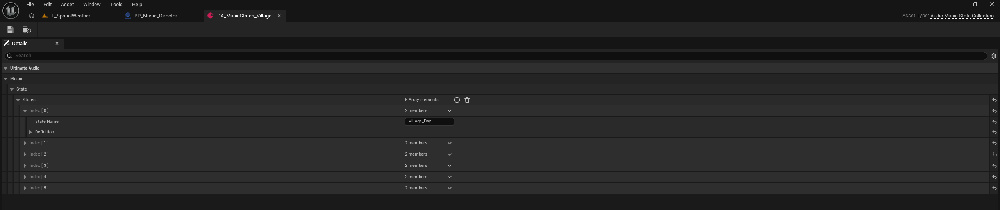

# Data Assets and Music States

UltimateAudio separates reusable audio data from the gameplay Blueprints that
request it. Create and configure the assets first; then refer to them from
actors, controllers, UI, triggers, or a central audio director.

## Creating assets

If the optional UltimateContentManager integration is active, use
**Content Browser > Right-click > UltimateGASP > Ultimate Audio**. Otherwise,
use the Content Browser's data-asset creation menu and search for the
UltimateAudio asset type.

Suggested naming:

| Asset type | Example |
| --- | --- |
| `Music Playlist` | `DA_Playlist_Exploration` |
| `Music State Collection` | `DA_MusicStates_Global` |
| `Audio Category Library` | `DA_AudioLib_UI` |
| `Audio Parameter Preset` | `DA_AudioParams_Combat` |
| `Audio Environment Profile` | `DA_AudioEnv_Cave` |

## Music Playlist

A playlist is the main music layer. Its `Tracks` array contains entries with:

- `Sound`: a valid `SoundWave`, `Sound Cue`, or `MetaSound`.
- `TrackName`: an optional name for UI and debugging; the sound asset name is
  used if this is empty.
- `FadeIn` and `FadeOut`: transition durations in seconds.
- `bLoopPlaylist`: whether playback returns to the start after the last track.
- `bShufflePlaylist`: whether track order is shuffled and reshuffled each
  playlist cycle.

Use separate playlists for distinct gameplay moods, such as menu,
exploration, combat, and boss. Automatic advance depends on the sound's
reported duration. A MetaSound with no known duration needs an explicit
Blueprint event that calls `UA Next Playlist Track`.

## Music State Collection

A collection is a registry of named music-state definitions. Each state has:

| Field | Purpose |
| --- | --- |
| `State Name` | Stable gameplay-facing name requested by Blueprint. |
| `Definition.Playlist` | Playlist selected when this state wins. |
| `Definition.Stinger` | Optional one-shot transition sound. |
| `Definition.Fade Time` | State-specific fade in seconds; a negative value uses the project default. |
| `Definition.Priority` | Resolves competing entries in the temporary state stack. |
| `Definition.Parameter Preset` | Optional set of float parameters applied for this state. |

Example:

| State | Playlist | Priority | Typical use |
| --- | --- | ---: | --- |
| `Exploration` | `DA_Playlist_Exploration` | 10 | Long-lived base state. |
| `Suspicion` | `DA_Playlist_Suspicion` | 30 | Temporary warning or investigation. |
| `Combat` | `DA_Playlist_Combat` | 60 | Active encounter. |
| `Boss` | `DA_Playlist_Boss` | 100 | Highest-priority encounter. |

Priority is not loudness. It only decides which requested music state wins.
When priorities tie, the most recently pushed state wins.



The screenshot is an actual project sample. It shows where the array lives in
the asset details; the sample also contains additional state entries.

## Choosing Activate, Push, and Pop

Use `UA Activate Music State` to establish a new base: a main menu, a new map,
or a chapter change. It clears temporary stack entries.

Use `UA Push Music State` for an event that can be removed later:

```text
Combat Started
-> UA Push Music State (Combat)

Combat Ended
-> UA Pop Music State (Combat)
```

While `Combat` is active, a higher-priority `Boss` state can be pushed. Popping
`Boss` reveals `Combat` again; popping `Combat` then reveals the base state.

Important:

- Register the collection before requesting a state by name.
- Add a matching pop for every successful push.
- Guard against duplicate pushes. If several enemies can request combat, use
  a director, counter, or set of active enemies rather than letting each
  enemy independently push and pop the same state.
- `UA Is Music State Active` identifies the selected state, not every state
  that remains hidden in the stack. Use `UA Get Music State Stack` when you
  need to inspect stack membership.
- Avoid calling `UA Play Music` or `UA Play Playlist` during a temporary
  state flow; direct playback clears the state-driven flow.

## Audio Category Library

An `Audio Category Library` maps cue names to cue data. Each cue contains:

| Field | Purpose |
| --- | --- |
| `Sound` | Sound asset played by the cue. |
| `Category` | `SFX`, `UI`, or another volume category. |
| `Pitch Min` / `Pitch Max` | Pitch variation range. |
| `Volume Min` / `Volume Max` | Playback-volume variation range. |
| `Weight` | Relative chance in random selection; `0` excludes the cue. |
| `Cooldown Seconds` | Minimum time before the same cue can be selected again. |

Use `UA Play Cue By Name` for a specific cue and `UA Play Random Cue` when any
eligible cue is suitable. Both are 2D playback. The random history and
cooldowns are reset when the map changes.

## Audio Parameter Preset

An `Audio Parameter Preset` contains named float values and three target
options:

- `bApplyToMusic`
- `bApplyToAmbiance`
- `bApplyToManagedSFX`

For example, `DA_AudioParams_Combat` could set `Threat = 1.0` and
`LowHealth = 0.0`. Configure the matching parameters inside the Sound Cue or
MetaSound. UltimateAudio sends values; it does not create an effect by itself.

Preset application does not remove parameters that are absent from the new
preset. Explicitly clear or replace old values when the design requires a
reset.

## Audio Environment Profile

An `Audio Environment Profile` groups zone-level settings:

- `SoundMix`: optional Unreal sound mix to push while the profile is current.
- `AmbianceSound`: optional ambience sound for the separate ambience layer.
- `AmbianceFadeTime` and `AmbianceVolume`.
- `bStopCurrentAmbianceIfNoSound`: stop existing ambience when applying a
  profile that has no ambience sound.
- `bStopAmbianceOnClear`: stop ambience when clearing this profile.
- `ParameterPreset`: optional float preset.

Use a profile for a room, biome, or persistent context. Keep the main
gameplay music in playlists and music states. Profiles do not form a stack:
applying a new profile replaces the current profile, and clearing it does not
automatically restore the last one. Float parameters previously applied by a
profile are not automatically cleared.

## Keep asset responsibilities separate

| System | Use it for | Do not use it as |
| --- | --- | --- |
| `Music Playlist` | Main music and track ordering | Zone ambience |
| `Music State Collection` | Named music states and priorities | Volume settings |
| `Audio Environment Profile` | Ambience, sound mix, and environment preset | Main combat/exploration music |
| `Audio Category Library` | Named/randomized one-shot cues | Playlist playback |
| `Audio Parameter Preset` | Named values delivered to audio components | A sound effect or automation by itself |
