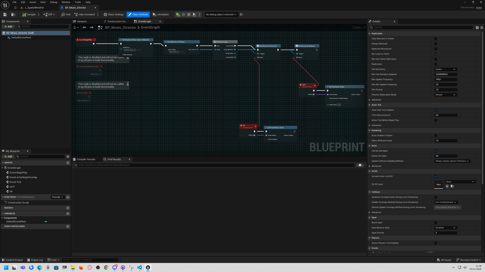

# Complete Blueprint Game Integration Guide

This guide combines the plugin's main features into a maintainable single-
player game workflow. It uses Blueprint nodes and data assets only.

## 1. Understand the runtime lifetime

UltimateAudio's manager belongs to the `GameInstance`, so its runtime state
can be reached across maps during the same game session. Music, ambience, and
managed audio components are associated with the active world; after a map
transition, the new map's director should register the state collection and
establish the music/environment it needs.

Call the nodes from a Blueprint that has a valid world context, such as an
Actor, Level Blueprint, or PlayerController. Do not call them from a
Construction Script.

## 2. Create the reusable audio data

At minimum, create:

- A `Music Playlist` for the menu or exploration base.
- A `Music Playlist` for combat.
- A `Music State Collection` containing both states.
- An `Audio Category Library` for UI and gameplay cues, if needed.
- An `Audio Environment Profile` for each persistent zone context, if needed.

For a small game, start with:

| State name | Playlist | Priority |
| --- | --- | ---: |
| `Exploration` | `DA_Playlist_Exploration` | 10 |
| `Combat` | `DA_Playlist_Combat` | 50 |
| `Boss` | `DA_Playlist_Boss` | 100 |

Priorities decide which state wins; they do not increase its volume.

## 3. Initialize the game

Create a central `BP_AudioBootstrap` or `BP_AudioDirector` that can make the
initial call once. In its `Event BeginPlay`:

```text
Event BeginPlay
-> UA Load Audio Settings (AudioPrefs)
-> UA Register Music State Collection (DA_MusicStates_Global, Clear Existing = true)
-> UA Activate Music State (MainMenu)
```

If the first map is a gameplay map, activate `Exploration` instead. Check the
boolean result of `UA Activate Music State`; a false result usually means the
requested state name is not registered or does not match exactly.

Load player preferences once when the game starts. `UA Load Audio Settings`
first restores project category defaults, then applies the save slot if it
exists. Re-loading it on every map change would reset runtime category values
before applying the saved values again.

## 4. Use the music-state stack for gameplay

From an encounter director or gameplay event:

```text
Encounter Started
-> UA Push Music State (Combat)
```

At the end of the encounter:

```text
Encounter Ended
-> UA Pop Music State (Combat)
```

Treat each push as a request that needs a matching pop. If several enemies
participate, keep the aggregation in one director:

```text
First relevant enemy enters combat
-> If ActiveCombatEnemyCount == 0: UA Push Music State (Combat)
-> Increment ActiveCombatEnemyCount

Relevant enemy leaves combat
-> Decrement ActiveCombatEnemyCount
-> If ActiveCombatEnemyCount == 0: UA Pop Music State (Combat)
```

In a real Blueprint, also guard against duplicate enter/exit notifications
for the same enemy; a set of active enemy references is safer than relying on
a counter alone.

The state stack supports nested events:

```text
Exploration (base)
-> Push Suspicion
-> Push Combat
-> Push Boss
-> Pop Boss       -> Combat wins again
-> Pop Combat     -> Suspicion wins again
-> Pop Suspicion  -> Exploration returns
```

Use `UA Activate Music State` for a new base, not for a temporary event: it
clears the temporary stack. If the base (for example, day/night music) can
change while temporary states are active, coordinate that change in one
director and keep the restore target current. Do not assume a profile or
playlist switch automatically updates a previously captured state-stack
restore point.

### Example Blueprint graph

This real sample graph registers the collection on `BeginPlay`, binds to
trigger events, pushes a named state on entry, and pops it on release. Adapt
the trigger class and collection to your project.



## 5. Change zone ambience and mix

Use a zone trigger to request the appropriate environment profile:

```text
Player Entered Cave
-> UA Apply Environment Profile (DA_AudioEnv_Cave)

Player Entered Exterior
-> UA Apply Environment Profile (DA_AudioEnv_Exterior)
```

An environment profile can combine a `SoundMix`, ambience, and a parameter
preset. It is not a profile stack. With overlapping zones, track which zone
should currently win in a central director. When leaving a zone, reapply the
still-active zone's profile instead of blindly clearing whatever profile is
current.

The ambience asset itself must be configured to loop if continuous playback
is intended. `UA Clear Environment Profile` does not restore the last profile
or clear float parameters applied earlier.

## 6. Drive parameters from gameplay events

Parameters must use the exact same name in the gameplay Blueprint and the
Sound Cue or MetaSound. For example:

```text
On Health Changed
-> Map Range Clamped (Health, 0, MaxHealth, 1, 0)
-> UA Set Audio Float Parameter (LowHealth, Result, Apply To Active Components = true)

Player Entered Water
-> UA Set Audio Float Parameter (Underwater, 1.0, true)

Player Left Water
-> UA Set Audio Float Parameter (Underwater, 0.0, true)
```

Prefer gameplay events over `Event Tick` for values that change only
occasionally. If a value must be sampled continuously, use a reasonable timer
or update interval.

Values stay stored until replaced or cleared. If you truly need to remove one,
use `UA Clear Audio Float Parameter`; choose its apply-zero option when active
components also need to receive zero. Clearing an environment profile does
not perform this parameter cleanup.

## 7. Play and control SFX

Use the node that matches the intended sound:

```text
Button OnClicked
-> UA Play SFX 2D Category (UI_Click, UI)

Impact Event
-> UA Play SFX At Location (ImpactSound, HitLocation)

Footstep Anim Notify
-> UA Play SFX Attached (Footstep, CharacterMesh, FootSocket)
```

The SFX nodes return an audio component. Keep the returned reference if you
need to stop/fade that particular managed SFX later with `UA Stop SFX`.
`UA Stop All Audio` affects audio launched through UltimateAudio; it does not
stop sounds owned by unrelated systems.

For variations and cooldowns, use `UA Play Cue By Name` or `UA Play Random
Cue` with an `Audio Category Library`. These cue nodes play in 2D; use the
location/attached SFX nodes for spatial sound.

## 8. Add dialogue ducking

When dialogue starts:

```text
Dialogue Started
-> UA Begin Ducking (Music, Duck To Volume Ratio = 0.3)
```

When dialogue ends:

```text
Dialogue Ended
-> UA End Ducking (Music)
```

Play voice sounds with `UA Play SFX 2D Category` using the `Dialogue`
category. `Music` ducking works directly. Ducking `SFX`, `UI`, or `Dialogue`
requires the matching `SoundClass` in project settings.

## 9. Save audio options

When the player confirms or closes the Options menu:

```text
UA Save Audio Settings (AudioPrefs)
```

Load the same slot once at game startup. See
[UMG audio options](05_UMG_Audio_Options.md) for a complete widget setup.

## 10. Test a map transition and an encounter

Use this checklist in a small test map before wiring the full game:

1. Start the map and verify the base playlist begins.
2. Push `Combat`; verify its playlist wins over the base.
3. Push `Boss`; verify the higher priority wins.
4. Pop `Boss`, then `Combat`; verify the intended previous states return.
5. Enter and leave an environment zone; verify the profile changes and that
   exit behavior matches its stop/clear options.
6. Change a category slider, save, restart, and confirm the value is restored.
7. Verify SFX categories with their `SoundClass` assigned.
8. Test MetaSounds with unknown duration separately; they may need manual
   playlist advance.

For individual node inputs and outputs, see the
[Blueprint node reference](02_Blueprint_Node_Reference.md).
