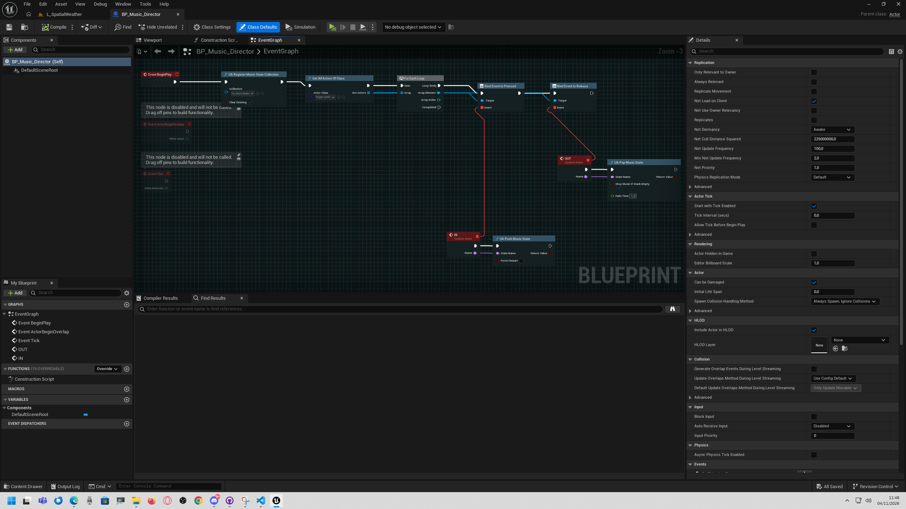
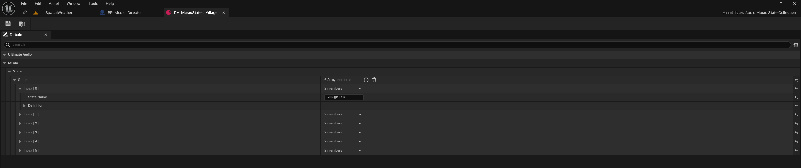

# UltimateAudio Documentation — English

This guide covers **Blueprint use only**. You do not need to write C++ to
follow the workflows. It targets Unreal Engine 5.8 and the single-player
runtime behavior provided by UltimateAudio.

The plugin descriptor currently marks UltimateAudio as beta. The sample
assets referenced here are in the main project under
`/Game/Addons/UltimateAudio`; they are examples, not required plugin content.

## Learning path

1. [Install and run a first Blueprint test](01_Getting_Started.md)
2. [Create playlists, cue libraries, and state collections](03_Data_Assets_and_States.md)
3. [Integrate UltimateAudio into a game](04_Blueprint_Game_Integration.md)
4. [Look up any Blueprint node](02_Blueprint_Node_Reference.md)
5. [Build an audio-options widget](05_UMG_Audio_Options.md)
6. [Use ready-to-adapt recipes and troubleshoot issues](06_Recipes_and_Troubleshooting.md)

## What UltimateAudio manages

- Music playback and playlists, including fades, pause/resume, and shuffle.
- Named music states with priorities and temporary stack overrides.
- A separate ambience layer and environment profiles.
- Managed 2D/3D SFX and named or randomized cue libraries.
- The `Music`, `SFX`, `UI`, and `Dialogue` volume categories.
- Runtime float parameters, ducking, and saved player preferences.

It does not replace sound authoring, Sound Cue/MetaSound design, attenuation,
mixing, or mastering. A float parameter only has an audible effect when the
Sound Cue or MetaSound also defines and uses that exact parameter name.

## Screenshots from the project

The screenshots show real UltimateAudio sample assets in Unreal Editor. They
are included as orientation; your own project will have different asset names
and data.

## Important behavior at a glance

- Use `UA Activate Music State` to establish a new base state. It clears the
  temporary state stack.
- Use `UA Push Music State` and a matching `UA Pop Music State` for temporary
  events such as combat, suspicion, or a boss phase.
- The highest-priority state in the stack wins; the most recently pushed state
  wins a priority tie.
- An environment profile is a single current profile, not a zone stack.
- `Music` volume is applied directly. `SFX`, `UI`, and `Dialogue` category
  volume, mute, and ducking require the matching `SoundClass` to be assigned
  in Ultimate Audio project settings.
- Player options should be loaded once at startup and saved when the player
  confirms changes.

For the detailed node behavior and edge cases, use the reference and
troubleshooting guide linked above.
