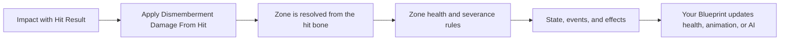

# Ultimate Dismemberment — Blueprint User Guide

This guide covers setup and use entirely through Unreal Editor and Blueprints.

> **Engine:** Unreal Engine 5.3 or later.  
> **Plugin version:** 1.0. Blueprint node and Details-panel labels are shown in their Unreal Editor spelling.

## Contents

1. [Overview](#1-overview)
2. [Installation and first setup](#2-installation-and-first-setup)
3. [Configure dismemberment zones](#3-configure-dismemberment-zones)
4. [Apply damage from a Blueprint](#4-apply-damage-from-a-blueprint)
5. [Events and gameplay logic](#5-events-and-gameplay-logic)
6. [Bleeding and character health](#6-bleeding-and-character-health)
7. [Visual effects, audio, and fragments](#7-visual-effects-audio-and-fragments)
8. [Tags, state, and animation](#8-tags-state-and-animation)
9. [Characters with multiple meshes](#9-characters-with-multiple-meshes)
10. [Networking and performance](#10-networking-and-performance)
11. [Blueprint node reference](#11-blueprint-node-reference)
12. [Troubleshooting](#12-troubleshooting)
13. [Checklist](#13-checklist)

## 1. Overview

UltimateDismemberment tracks health for configured character zones. Based on incoming damage and each zone's rules, it can report a wound, crippled state, or severance. The component can also produce visual effects, physics fragments, decals, and Blueprint events.

The plugin does not replace your game's health system. Your Blueprints decide how regular damage, bleeding, defeat, and death affect that system.

### Basic flow

### Requirements

- A Character or Pawn Blueprint with a Skeletal Mesh.
- Collision or a trace that supplies a `Hit Result` containing a bone name.
- Zone bone names that match the skeleton used by the target mesh.
- Niagara systems, materials, and sounds if you want to enable those optional effects.

## 2. Installation and first setup

1. Enable **UltimateDismemberment** in **Edit > Plugins**.
2. Restart Unreal Editor if prompted.
3. Open your character Blueprint.
4. In **Components**, choose **Add** and add **Ultimate Dismemberment Component**.
5. Select the component and confirm **Dismemberment Enabled** is checked.
6. Leave **Target Mesh Name (empty = auto)** empty to let the component locate the character mesh automatically.
7. For a humanoid skeleton matching the plugin's default bone layout, keep **Auto-Populate Default Zones** enabled. If **Dismemberment Zones** is empty, the plugin fills it at startup.
8. Compile and save the Blueprint.

The **Populate Default Zones** button replaces the current zone entries with the preset. Use it only when you want to start over from that preset; configure zones manually for a custom skeleton.

## 3. Configure dismemberment zones

Each entry in **Dismemberment Zones** represents an independent zone. Expand an entry in the **Details** panel to edit it.

### Zone properties

| Details property | Purpose |
|---|---|
| **Limb Type** | Recognized type: head, upper arm, forearm, hand, thigh, shin, foot, torso, or custom zone. |
| **Display Name** | Readable label for configuration and diagnostics. |
| **Root Bone** | Starting bone for the zone. It must exist on the target mesh skeleton. |
| **Child Bones** | Additional bones to hide. Leave empty to collect the bone subtree automatically. |
| **Excluded Bones (auto-collect)** | Bones excluded from automatic collection for this zone. |
| **Stump Bone** | Bone that remains on the character and can host wound effects. |
| **Max Health** | Maximum health for the zone. |
| **Min Single Hit Damage To Sever** | Minimum damage from one hit required to allow severance. |
| **Can Be Severed** | Enables or prevents severance for this zone. |
| **Is Critical Limb (death if severed)** | Marks the zone as critical. Your game's Blueprint remains responsible for death logic. |
| **Required Weapon Tags (optional)** | Tags required to sever this zone. An empty list requires no weapon tag. |
| **Ejection Impulse / Ejection Direction Local / Angular Impulse** | Initial movement and spin of the severed fragment. |
| **Bleed Damage Per Second / Bleed Duration (s)** | Bleed strength and maximum duration for the zone. |
| **Locomotion Penalty** | Contribution of this zone to movement penalties. |
| **Severed Tag / Crippled Tag** | Tags broadcast when the matching state is reached. |
| **Stump Cap Mesh (optional, hides seam)** | Optional mesh that covers the visible seam after severance. See the [Stump Cap guide](STUMP_CAP_GUIDE.md). |

### Custom skeletons

For a skeleton that does not match the default layout:

1. Disable **Auto-Populate Default Zones** if you do not want the preset zones.
2. Add an entry to **Dismemberment Zones** for each zone you need.
3. Choose a **Limb Type** (or **Custom**) and set **Root Bone** to the exact bone name.
4. Enter child bones manually if automatic collection does not match your rig.
5. Use **Get Bone Mapping Report** and **Enable Debug Mode** to find missing or misspelled bones.

Left and right sides follow the skeleton's own bone names. Check them in the Skeletal Mesh editor before entering values.

## 4. Apply damage from a Blueprint

### From a point-damage event

In the Blueprint of the character receiving the impact:

1. Add **Event Point Damage**.
2. From the event, search for **Apply Dismemberment Damage From Hit**.
3. Connect the values:
   - **Target**: the character that owns the component, usually `Self`.
   - **Hit Result**: the event's `Hit Info` pin.
   - **Damage**: the event's `Damage` pin.
   - **Damage Causer**: the matching event pin, if available.
   - **Weapon Tags**: the weapon's tags, or an empty container if you do not use this filter.
4. Use the returned severity if you want to trigger an additional reaction.

The node reads the bone name from the `Hit Result` to find the zone automatically. If a weapon Blueprint performs the trace, pass the hit actor as **Target** and the trace result as **Hit Result**.

### When the zone is already known

Use **Apply Dismemberment Damage To Limb** when gameplay already knows which zone was hit. Supply the character, zone type, damage, impact location and direction, optional weapon tags, and the actor responsible for the hit.

The **Apply Damage To Limb** node, available from a component reference, also applies damage directly to one zone.

### Rules to check

- Damage is multiplied by **Global Limb Damage Multiplier**.
- Severance requires **Can Be Severed** to be enabled.
- A single hit must meet **Min Single Hit Damage To Sever**.
- If **Required Weapon Tags (optional)** contains tags, the damage must provide the required weapon tags.
- **Force Sever Limb** bypasses normal health and damage checks. Reserve it for explicitly scripted events.

## 5. Events and gameplay logic

In the Event Graph, drag the component from **Components** and add events for its dispatchers:

| Component dispatcher | Common use |
|---|---|
| **OnLimbSevered** | Animation reaction, sound, UI update, or gameplay logic after severance. |
| **OnLimbCrippled** | React when a zone enters the crippled state. |
| **OnBleedingStarted** | Show an indicator, start health logic, or notify AI. |
| **OnBleedingStopped** | Remove the indicator or stop related reactions. |
| **OnCriticalLimbSevered** | Trigger the game's own defeat or death logic. |
| **OnStatusChanged** | Update animation, UI, or AI from the received summary. |

A critical zone does not automatically kill the character by default. In **Settings**, **Dispatch Critical Limb Hook** is enabled by default and **Request Owner Death On Critical Limb** is disabled by default. Connect the critical event to your own defeat logic, or explicitly enable the requested behavior if it suits your game.

For centralized gameplay logic, implement **DismembermentInterface** in the character Blueprint's **Class Settings > Implemented Interfaces**. Useful interface events include **OnDismembermentLimbSevered**, **OnDismembermentCriticalLimbSevered**, **OnDismembermentOwnerDefeated**, and **OnDismembermentApplyBleedDamage**.

## 6. Bleeding and character health

UltimateDismemberment calculates bleed damage, but your game decides how it affects overall health.

1. Implement **DismembermentInterface** on the character Blueprint.
2. Add the **OnDismembermentApplyBleedDamage** interface event to the Event Graph.
3. Connect its damage value to your game's existing health logic.
4. If you do not want continuous damage, disable **Apply Continuous Bleed Damage** in **Settings**.
5. Adjust **Bleeding Enabled**, **Bleed Damage Tick Interval (s)**, and **Natural Cauterization Time (s, 0 = limb duration)** as needed.

To stop bleeding, call **Cauterize Limb** or **Cauterize All**. These nodes do not undo severance. To restore the character after respawn, use **Reset Dismemberment State** and review its health-restore, fragment-cleanup, and effect-cleanup options.

## 7. Visual effects, audio, and fragments

Select the component and configure the **Visual Effects** and **Audio** sections in **Details**. Asset references are optional: an empty field means that particular effect is not played.

### Niagara effects and decals

Available slots cover effects such as blood spray, drips, pools, trails, wounds, critical severance, and debris. Assign only the systems used by your game. **VFX Enabled** and **Blood Decals Enabled** toggle these categories; **Max Active Blood Decals** limits how many decals remain active.

Decals require a material compatible with deferred decal projection. Configure decal size, lifetime, and count per severance in **Visual Effects**.

### Physics fragments

**Physics Fragments Enabled** toggles fragments. **Fragment Lifetime**, **Fragment Fade-Out Time**, **Max Active Fragments**, and **Fragment Gravity Scale** control their lifetime and cost.

For the fragment fade to be visible, its material must use the scalar parameter `DissolveAmount`. Without that parameter, the fragment may appear but will not dissolve visually.

### Audio

Assign optional severance and bleeding sounds in the component's **Audio** section. Leaving a sound unassigned does not prevent other plugin features from working.

## 8. Tags, state, and animation

Each zone can provide **Severed Tag** and **Crippled Tag**. Gameplay Tags are optional; they only affect behavior when your Blueprints check them.

Useful nodes for reading state:

- **Is Limb Severed**, **Is Limb Crippled**, **Get Limb Health Percent**, and **Get Limb State**.
- **Get Severed Limbs**, **Get Crippled Limbs**, and **Get Dismemberment Status Summary**.
- **Can Character Walk**, **Can Character Run**, **Can Character Use Left Arm**, and **Can Character Use Right Arm**.
- **Get Defeat Summary** and **Get Combat Readiness Summary** for broader gameplay decisions.

Use these results in an Animation State Machine, widget, or Blueprint AI logic. The plugin supplies state; your game chooses animations, speeds, and reactions.

## 9. Characters with multiple meshes

If a character is rendered by multiple Skeletal Mesh Components:

- For meshes directly on the same actor, set **Visual Override: Mesh Component Names (direct, no child actor)**.
- If the meshes belong to a child actor, set **Visual Override: Child Actor Component Name** or pass the visual actor to **Set Visual Override Actor**.
- If visual components are created after startup, call **Refresh Visual Mesh Cache** after creation. You can also add selected meshes with **Add Visual Override Mesh Component**.

In a Blueprint, wait until the child actor is available before passing it to the component. Then check the result with **Get Bone Mapping Report**. A mesh that does not contain the target bone cannot hide that bone.

## 10. Networking and performance

For a networked game, the actor that owns the component must replicate, and damage application must follow the game's server-authority flow. **Replicate Fragments** and **Replicate Decals** control replication of those effects. Test in a network session, including for players who join after a severance.

To limit cost:

- reduce **Max Active Fragments** and **Max Active Blood Decals** for your scene;
- disable **Physics Fragments Enabled**, **VFX Enabled**, or **Blood Decals Enabled** when those effects are unnecessary;
- keep **Skip Runtime Cost When Owner Hidden** enabled if its behavior fits your game;
- keep **Enable Debug Mode** disabled outside diagnostics.

## 11. Blueprint node reference

| Node | Purpose |
|---|---|
| **Apply Dismemberment Damage From Hit** | Resolves the zone from the `Hit Result` bone. |
| **Apply Dismemberment Damage To Limb** | Applies damage to a specified zone. |
| **Apply Damage To Limb** | Component-reference version for direct zone damage. |
| **Force Sever Limb** | Forces severance without normal damage checks. |
| **Get Bone Mapping Report** | Reports configured bones and bones that were not found. |
| **Get Dismemberment Status Summary** | Provides overall zone, movement, and bleeding status. |
| **Cauterize Limb / Cauterize All** | Stops bleeding on one zone or all zones. |
| **Reset Dismemberment State** | Restores initial state according to the supplied options. |
| **Stop All Effects (on death)** | Stops active audio, visual effects, and fragments without restoring zone state. |
| **Set Visual Override Actor** | Registers the actor that carries the visual meshes. |

## 12. Troubleshooting

| Symptom | Check |
|---|---|
| No limb is detected | Confirm the `Hit Result` contains a bone name and **Root Bone** exactly matches the target Skeletal Mesh. |
| The wrong zone is detected | Compare the name returned in the `Hit Result` with **Root Bone** and **Child Bones**. |
| A zone cannot be severed | Check **Can Be Severed**, **Min Single Hit Damage To Sever**, and **Required Weapon Tags (optional)**. |
| No fragment appears | Check **Physics Fragments Enabled**, **Max Active Fragments**, and that the mesh has a Physics Asset. |
| No visual effect appears | Check **VFX Enabled** and assign the relevant assets in **Visual Effects**. |
| Bleeding does not reduce health | Check **Bleeding Enabled**, **Apply Continuous Bleed Damage**, and the Blueprint implementation of **OnDismembermentApplyBleedDamage**. |
| A secondary mesh remains unchanged | Check Visual Override setup and confirm that mesh contains the target bone. |
| A bone is missing on a custom rig | Enable **Enable Debug Mode**, inspect **Get Bone Mapping Report**, and correct the zone bone names. |
| A fragment does not dissolve | Confirm its material uses the `DissolveAmount` parameter. |

## 13. Checklist

- [ ] The component is added to the character Blueprint and enabled.
- [ ] Zone definitions match the target mesh bones.
- [ ] The `Hit Result` reaching the damage node contains a usable bone name.
- [ ] Damage thresholds and weapon tags match the intended gameplay.
- [ ] Character health and death are connected to the game's Blueprint logic.
- [ ] Effect assets are assigned only when needed.
- [ ] Characters with multiple meshes have a valid Visual Override setup.
- [ ] Test in gameplay, then in a network session if the project uses multiplayer.
